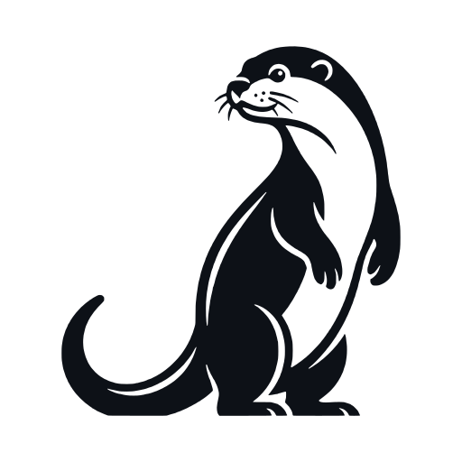
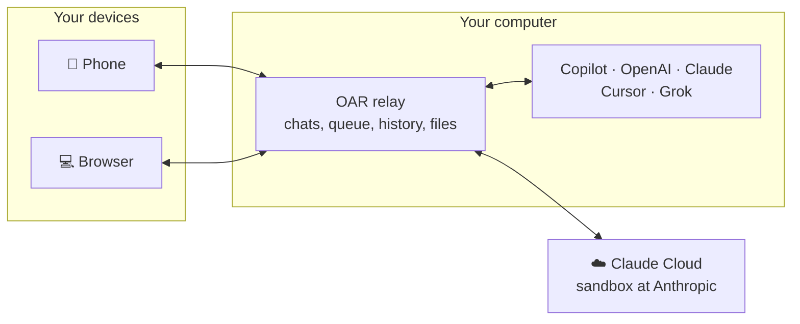
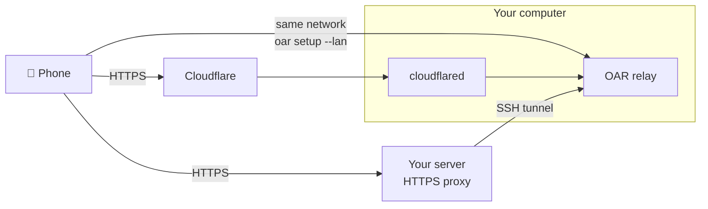
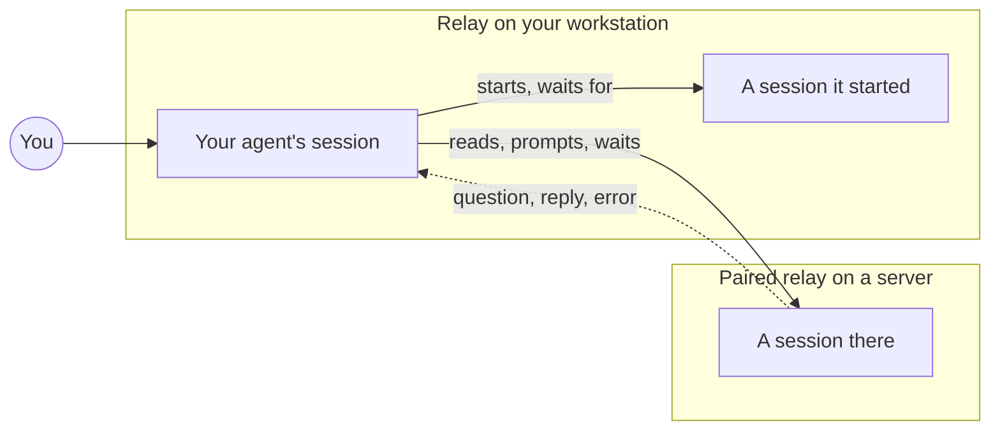

<p align="center">
  <picture>
    <source media="(prefers-color-scheme: dark)" srcset="server/public/app-icon.svg">
    
  </picture>
</p>

# OAR — Open Agent Relay

Drive the coding agents on your machine from any browser (phone, tablet, or a second computer) through a web relay you host yourself.

```bash
curl -fsSL oar.sh/install | sh
```

On Windows, run `irm oar.sh/install.ps1 | iex` in PowerShell. Other ways to install are under [Install](#install). Landing page: [oar.sh](https://oar.sh); the complete guide: [oar.sh/docs](https://oar.sh/docs/).

## What OAR does

Coding agents such as GitHub Copilot, Claude Code, Cursor and Grok usually live in a terminal. OAR puts them into a chat you can open anywhere: start a task at your desk, follow it from the sofa, answer the agent's question from your phone. The agents keep running on your own computer, with your files and your logins; OAR passes the conversation back and forth.



- **Seven runtimes, one chat**: you pick the agent per conversation, and all of them share the same chat, queue, history, file browser, and question cards ([Runtimes](#runtimes)).
- **Yours**: the relay runs on your hardware, answers only on this machine until you change that, and collects no telemetry ([Security notes](#security-notes)).
- **Under active development**: expect occasional rough edges, and some provider SDK features that are missing or incomplete.

## In action

<table>
<tr>
<td width="42%" rowspan="4" valign="top">
<a href="https://oar.sh/assets/shots/cfmail-mobile.png?v=0.9.11"><picture><source media="(prefers-color-scheme: light)" srcset="https://oar.sh/assets/shots/cfmail-mobile.light.png?v=0.9.11"></picture></a>
<br><sub>On a phone: the same conversations, installable as an app.</sub>
</td>
<td width="58%" valign="top">
<a href="https://oar.sh/assets/shots/cfmail-agents.png?v=0.9.11"><picture><source media="(prefers-color-scheme: light)" srcset="https://oar.sh/assets/shots/cfmail-agents.light.png?v=0.9.11"></picture></a>
<br><sub>Agents working in parallel, each with live token counts and its own Stop.</sub>
</td>
</tr>
<tr>
<td valign="top">
<a href="https://oar.sh/assets/shots/cfmail-question.png?v=0.9.11"><picture><source media="(prefers-color-scheme: light)" srcset="https://oar.sh/assets/shots/cfmail-question.light.png?v=0.9.11"></picture></a>
<br><sub>When the agent needs a decision, it asks, and waits for your answer.</sub>
</td>
</tr>
<tr>
<td valign="top">
<a href="https://oar.sh/assets/shots/pingcf-thoughts.png?v=0.9.11"><picture><source media="(prefers-color-scheme: light)" srcset="https://oar.sh/assets/shots/pingcf-thoughts.light.png?v=0.9.11"></picture></a>
<br><sub>Read the reasoning, not just the answer.</sub>
</td>
</tr>
<tr>
<td valign="top">
<a href="https://oar.sh/assets/shots/pagewright-watching.png?v=0.9.11"><picture><source media="(prefers-color-scheme: light)" srcset="https://oar.sh/assets/shots/pagewright-watching.light.png?v=0.9.11"></picture></a>
<br><sub>Agents that watch agents: woken by events, approving nothing.</sub>
</td>
</tr>
</table>

<a id="quick-start"></a>
<a id="prerequisites"></a>
<a id="start-the-relay"></a>
<a id="the-oar-command"></a>

## Install

1. **Install.** Run `curl -fsSL oar.sh/install | sh` (macOS, Linux) or `irm oar.sh/install.ps1 | iex` (Windows PowerShell). On macOS and Linux the installer says what it is about to do and asks once, then installs OAR into your home directory, writes a config with a fresh access token, starts the relay, and prints its address with a QR code. On Windows, run `oar start` afterwards.
2. **Open the address** it printed; `oar url` prints it again. On the relay's own machine that is `http://localhost:3333/`. For your phone, switch on LAN access with `oar setup --lan`, or use a [tunnel](#remote-access).
3. **Turn on an agent** under **⚙️ Settings → Providers**, then start a conversation with **+ New Chat**.

You need Node.js 22.13 or newer (the macOS and Linux installer brings its own when yours is missing or older) and an account with the agent you want to use; see [Prerequisites](docs/install.md#prerequisites). There are also installs [with npm](docs/install.md#npm) and [from a git checkout](docs/install.md#from-a-git-checkout).

`oar` alone opens a menu. `oar start`, `stop`, `restart` and `status` control the relay, `oar service install` starts it at every login, `oar doctor` shows what it uses, and `oar update` installs a new release (as does **⚙️ Settings → General → Check for updates**). All the details are in [Installing and running OAR](docs/install.md): [the `oar` command](docs/install.md#the-oar-command), [where OAR keeps its files](docs/install.md#where-oar-keeps-its-files), and [updating](docs/install.md#updating).

<a id="providers"></a>
<a id="claude-cloud"></a>
<a id="claude-agent-sdk"></a>

## Runtimes

The runtime (the *provider* in the UI) is chosen in **New Chat** and stays fixed for that conversation.

| Runtime | What it is | What you need |
| ------- | ---------- | ------------- |
| [**GitHub Copilot**](docs/providers.md#github-copilot--engine-choice) (default) | GitHub's coding agent, with every model your Copilot plan offers | The Copilot CLI, signed in on the relay host |
| [**OpenAI (BYOK)**](docs/providers.md#openai-byok-and-openai-image) | Copilot's agent against OpenAI or a compatible endpoint | Your own API key |
| [**OpenAI Image**](docs/providers.md#openai-byok-and-openai-image) | A chat whose replies are images | The same key |
| [**Claude**](docs/providers.md#claude-agent-sdk) | Claude Code on your machine | A Claude login, made from **⚙️ Settings** |
| [**Claude Cloud**](docs/providers.md#claude-cloud) (experimental) | Claude Code in a sandbox at Anthropic, on a GitHub repository | A claude.ai account with GitHub connected |
| [**Cursor**](docs/providers.md#cursor-agent-sdk) | Cursor's agent | A Cursor API key |
| [**Grok**](docs/providers.md#grok-cli-acp) | xAI's Grok CLI | A Grok sign-in, made from **⚙️ Settings** |

API keys are entered in **⚙️ Settings** and stay on the relay host. The Claude and Grok CLIs can be [installed and signed in to from the browser](docs/providers.md#installing-a-provider-cli-from-the-relay), so no shell on the host is needed. Each runtime discovers its own [models](docs/providers.md#models). The full picture of each runtime is in [Providers](docs/providers.md).

<a id="highlights"></a>
<a id="using-the-web-ui"></a>

## What you can do

<table>
<tr>
<td width="62%" valign="top">
<a href="https://oar.sh/assets/shots/cfmail-steering.png?v=0.9.11"><picture><source media="(prefers-color-scheme: light)" srcset="https://oar.sh/assets/shots/cfmail-steering.light.png?v=0.9.11"></picture></a>
<br><sub>Send a message while the agent works, and it steers the running turn.</sub>
</td>
<td width="38%" valign="top">
<a href="https://oar.sh/assets/shots/usage-copilot-compact.png?v=0.9.11"><picture><source media="(prefers-color-scheme: light)" srcset="https://oar.sh/assets/shots/usage-copilot-compact.light.png?v=0.9.11"></picture></a>
<br><sub>What each plan has left, in one place.</sub>
</td>
</tr>
</table>

- **Watch a turn live**: the reply, the agent's thoughts and every tool call appear as they happen, and each sub-agent gets a bubble of its own. **Stop** is always one tap away ([While a turn runs](docs/web-ui.md#while-a-turn-runs)).
- **Steer or queue**: a message sent during a turn goes into it (Claude, Copilot) or waits behind it ([While a turn runs](docs/web-ui.md#while-a-turn-runs)).
- **Answer questions**: the agent asks on a card with one-click choices, checkmarks or free text, and waits for you ([Question cards](docs/web-ui.md#question-cards)).
- **Background work**: a task panel lists the commands and sub-agents that outlive a reply, each with its own **Stop** and its full record ([Background tasks](docs/web-ui.md#background-tasks)).
- **Choose how the agent works**: `ask`, `plan`, `agent` or `autopilot`, plus model and reasoning effort, per message ([Relay modes](docs/web-ui.md#relay-modes)).
- **Files and git**: browse the workspace, preview files, review git changes in a diff viewer, and publish a dev server as a preview link ([Files, git, and previews](docs/web-ui.md#files-git-and-previews), [preview servers](docs/preview-servers.md)).
- **Usage and context**: plan limits and credits of every provider, and what fills the model's context window ([Usage and context](docs/web-ui.md#usage-and-context)).
- **Your conversations everywhere**: the history lives on the relay, drafts follow you from device to device, and conversations can be searched, archived, grouped and pinned ([The conversation list](docs/web-ui.md#the-conversation-list), [drafts](docs/web-ui.md#drafts-across-devices), [session groups](docs/web-ui.md#session-groups), [pins](docs/web-ui.md#pinned-messages)).
- **Share** a conversation as a read-only link, hide single messages and the host's paths from it, and see when it was opened ([Sharing](docs/web-ui.md#sharing)).
- **On your phone**: install OAR as an app and get push notifications ([Notifications and the app](docs/web-ui.md#notifications-and-the-app)).

The full tour is in [Using the web UI](docs/web-ui.md); every setting and config key is in [Settings and configuration](docs/configuration.md). What changed in each release is in the [changelog](CHANGELOG.md), with [0.9.11](CHANGELOG.md#0911--2026-10-17) as the latest.

## Remote access

Out of the box the relay answers only on its own machine. There are three ways to reach it from elsewhere:

- **Same network**: `oar setup --lan` opens the relay to your LAN and prints a QR code for your phone.
- **Cloudflare Tunnel**: no server of your own and no open port. You need a Cloudflare account and `cloudflared` on the relay host ([how](docs/remote-access.md#optional-remote-internet-access-cloudflare-tunnel)).
- **SSH tunnel**: through a server you already run, behind your own HTTPS proxy ([how](docs/remote-access.md#optional-remote-internet-access-ssh-tunnel)).



The relay keeps both tunnels running and reconnects them by itself. Beyond your own network, always go through HTTPS. Behind a reverse proxy of your own on another host, tell the relay to trust it ([how](docs/remote-access.md#behind-a-reverse-proxy)). The details are in [Remote access](docs/remote-access.md).

<a id="remote-relays"></a>
<a id="agent-sessions"></a>
<a id="watching-sessions"></a>

## Agents working together

- **Paired relays**: connect the OAR on your workstation with the OAR on a server. An agent on one can then read, prompt and start sessions on the other, once you mention that relay with `@`.
- **Agent sessions**: an agent hands parts of its task to new sessions on its own relay, waits for them and reads their results. It is off until you switch it on, the first session asks for your approval, and at most 4 run at once.
- **Watching sessions**: an agent subscribes to other sessions and is woken when a question waits, an error happens, or a reply arrives, instead of polling.



You stay in charge: per paired relay you decide whether agents may only read, also prompt, or do everything, and in the `ask` and `plan` modes every write asks you first. A subscription only notifies; it approves nothing.

<p><a href="https://oar.sh/assets/shots/pagewright-cross-relay.png?v=0.9.11"><picture><source media="(prefers-color-scheme: light)" srcset="https://oar.sh/assets/shots/pagewright-cross-relay.light.png?v=0.9.11"></picture></a></p>

How pairing, permissions and limits work is in [Agents working together](docs/agents-together.md).

## Security notes

- **The access token is the key to everything.** Whoever holds it, or a URL carrying `?token=`, can have your agents run commands on the host. Treat it like a password; `oar setup --new-token` replaces it and signs every device out.
- **OAR adds reach, not a sandbox.** Agents act with the permissions of the user the relay runs as.
- **Local by default.** The relay answers only on its own machine until you change that. Beyond your network, use one of the [tunnels](#remote-access).
- **Public links are public.** Anyone with a shared-conversation or preview link can open it without signing in.
- **No telemetry.** The only request to oar.sh is the update check, and it is off until you turn it on.

How keys, cookies, served files, paired relays and Claude Cloud's use of the Claude login are handled: [Security notes](docs/security.md).

## Troubleshooting

| Symptom | What to do |
| ------- | ---------- |
| A runtime is missing from **New Chat** | Turn it on in **⚙️ Settings → Providers**; all of them except Copilot are off until you do |
| A reply says a CLI is missing or signed out | Press the button on the failed reply (**Install Grok CLI**, **Sign in to Grok**, **Claude settings**) |
| Banner says *CLI is offline* | Normal on an idle relay: send a message, and the banner clears once the conversation's worker connects |
| A conversation seems wedged | **☠️ Kill session** in the `⋯` menu, then retry or send a new message |
| `npm install -g @oar-sh/oar` fails with `EACCES` | Do not use `sudo`; run the installer, which installs into your home directory |

`oar doctor` prints the version, paths, port and provider CLIs in use. More symptoms are in [Troubleshooting](docs/troubleshooting.md).

<a id="settings-and-configuration-reference"></a>
<a id="repository-layout"></a>

## Documentation

| Guide | What is in it |
| ----- | ------------- |
| [Installing and running OAR](docs/install.md) | Prerequisites, every install method, starting the relay, the `oar` command, files, updating |
| [Providers](docs/providers.md) | Each runtime in detail, installing provider CLIs from the relay, models |
| [Using the web UI](docs/web-ui.md) | Conversations, running turns, question cards, background tasks, files, usage, sharing, the menu |
| [Settings and configuration](docs/configuration.md) | Settings, `config.json`, environment variables, stuck-turn detection |
| [Remote access](docs/remote-access.md) | SSH and Cloudflare tunnels, a reverse proxy on another host, the session-worker path guard |
| [Agents working together](docs/agents-together.md) | Paired relays, agent sessions, watching sessions |
| [Security notes](docs/security.md) · [Troubleshooting](docs/troubleshooting.md) | The full lists |
| [Preview servers](docs/preview-servers.md) · [Copilot CLI with your own key](docs/copilot-cli-byok.md) | Publishing dev servers; BYOK notes |
| [DEVELOPING.md](DEVELOPING.md) · [server/README.md](server/README.md#api-reference) · [CHANGELOG.md](CHANGELOG.md) | Development, tests, relay internals and the repository layout; the HTTP API; release notes |

The most complete guide, in six languages, is [oar.sh/docs](https://oar.sh/docs/).
